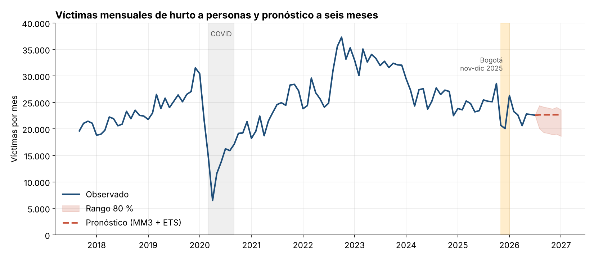
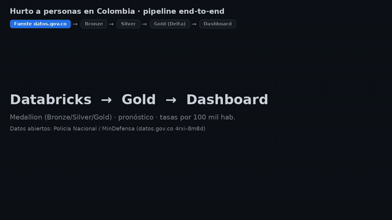
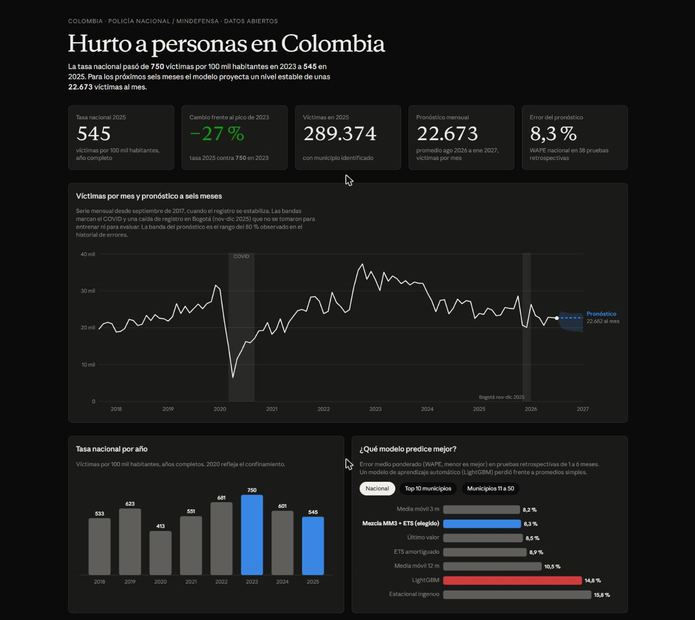
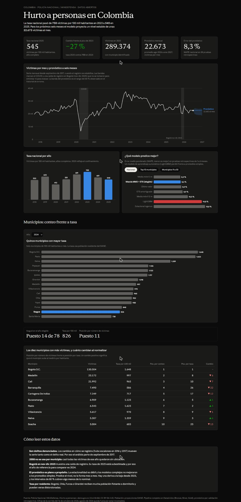
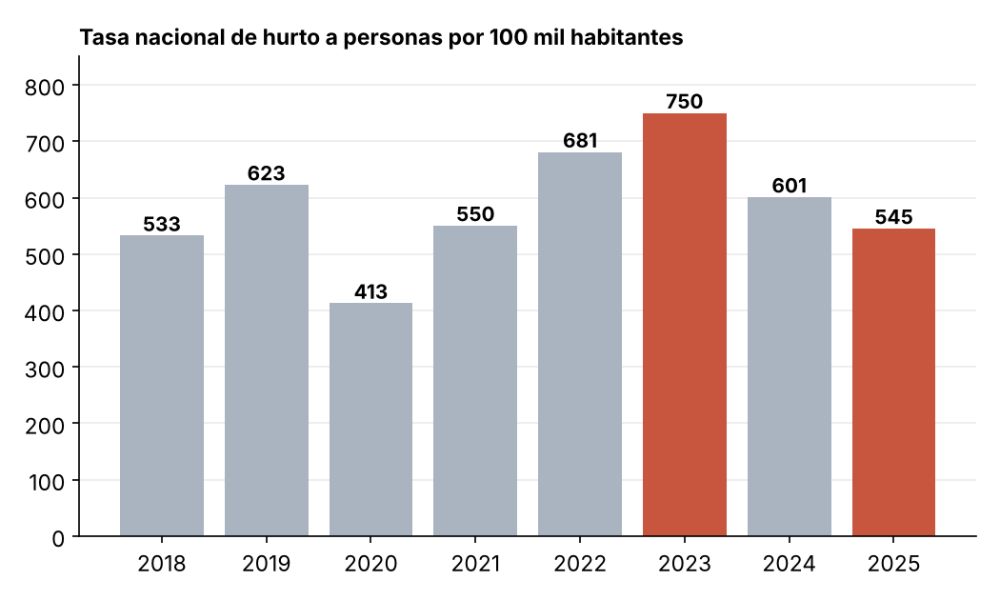
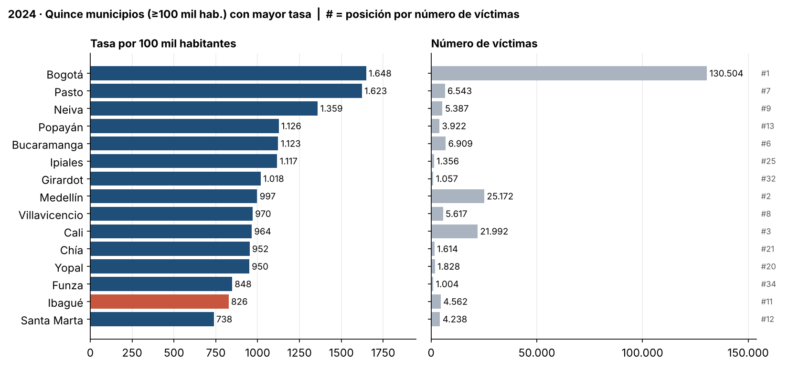
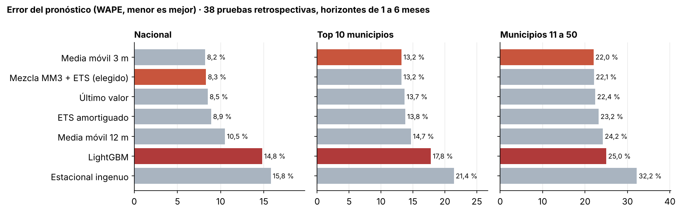

# Hurto a personas en Colombia: de qué sirve medir por habitante y qué tan predecible es

**Python · Databricks (Spark, Delta, Unity Catalog) · SQL · statsmodels · LightGBM · datos abiertos de Colombia**

## Resumen ejecutivo
**Problema:** el número de víctimas de hurto a personas se usa para comparar municipios y ver tendencias, pero depende del tamaño de la población y de cómo se registra. ¿Qué dicen realmente los datos y qué tan predecible es la serie?
**Hallazgo principal:** la tasa nacional subió de 533 (2018) a 750 (2023) y bajó a 545 víctimas por 100 mil habitantes en 2025; y al normalizar por población el ranking cambia: Barranquilla pasa del puesto 4 por número de víctimas al 26 por tasa, y Pasto del 7 al 2.
**Recomendación:** comparar municipios por tasa (no por conteo) y leer las tendencias solo desde septiembre de 2017, porque la serie tiene escalones de registro.
**Impacto:** no aplica. Es un análisis exploratorio y predictivo; no se implementó ninguna decisión a partir de él.



### Dashboard

Los datos del dashboard son una copia exportada de las tablas Gold (no una conexión en vivo). El recorrido muestra el flujo Gold → dashboard:





<details>
<summary>Ver el dashboard completo (municipios, Ibagué, conteo vs tasa y notas de lectura)</summary>



</details>

Más detalles en [`dashboard/README.md`](dashboard/README.md).

<details>
<summary><b>English summary</b></summary>

End-to-end project on Colombian open data (Ministry of Defense, 651,200 daily-by-municipality rows, 3.77 M victims of theft against persons, 2003–2026). I built a medallion pipeline (Bronze/Silver/Gold) on Databricks, an EDA that uncovered registry breaks in the series, population-adjusted rates per 100k inhabitants (DANE), and a 6-month forecast validated with a rolling-origin backtest over 38 origins. Key results: the national rate peaked at 750 per 100k in 2023 and fell to 545 in 2025; normalizing by population reshuffles the municipal ranking (Barranquilla #4 by count → #26 by rate); and simple averages (WAPE 8.3 % nationally) beat a LightGBM model (14.8 %), so the forecast is a flat level around 22,700 victims per month. Limitations: reported crimes only, registry changes in 2016/2017, provisional recent months.
</details>

## Contexto y problema de negocio
Las autoridades y los medios comparan ciudades con el número de víctimas, y las series de varios años se leen como si midieran el delito. Dos cosas lo complican: Bogotá tiene 7,9 millones de habitantes y cualquier ranking por conteo la pone primero por tamaño, y la serie nacional tiene saltos que parecen cambios de registro.

Preguntas que responde el proyecto:
1. ¿Cómo evolucionó el hurto a personas y cuánto de ese movimiento es confiable?
2. ¿Qué municipios concentran las víctimas y cuáles destacan al normalizar por población?
3. ¿Hay estacionalidad que se pueda usar?
4. ¿Qué proyección es defendible a seis meses y con qué error?

## Datos
| Aspecto | Detalle |
|---|---|
| Fuente | Ministerio de Defensa Nacional, Observatorio MDN, "HURTO PERSONAS", [datos.gov.co](https://www.datos.gov.co/d/4rxi-8m8d) (ID `4rxi-8m8d`, CC BY-SA 4.0) |
| Población | DANE, proyecciones de población municipal (serie 2005-2017 y serie 2018-2042) |
| Tamaño | 651.200 filas, 3.774.742 víctimas |
| Periodo | 01/01/2003 a 31/08/2026 (extracción del 16/10/2026) |
| Granularidad | víctimas por día y municipio (los días sin casos no aparecen y se completan con ceros) |
| Calidad | 2008 no sirve por municipio (el 96,5 % de sus víctimas no tiene ubicación); escalones de registro en enero de 2016 y agosto de 2017; caída anómala de Bogotá en nov-dic de 2025; agosto de 2026 incompleto |

## Enfoque
1. **Bronze:** ingesta del CSV a Delta con todas las columnas como texto, sin interpretar fechas ni códigos.
2. **Silver:** tipado, estandarización y banderas de calidad. No se eliminan filas: cada exclusión se mide y se documenta ([`docs/decisiones.md`](docs/decisiones.md)).
3. **Gold:** panel mensual por municipio con ceros desde el primer mes de cada municipio, agregados por departamento y país, y la serie diaria.
4. **EDA:** escalones de registro, anomalías, estacionalidad, concentración y dispersión. De ahí salen las decisiones del modelo: ventana desde septiembre de 2017 y enmascarar el COVID y la anomalía de Bogotá.
5. **Tasas:** población DANE por municipio y año, empalmando dos series (hay un salto de +1,8 % a nivel nacional entre 2017 y 2018, frente a un crecimiento anual típico de 1,2 %).
6. **Predicción:** backtest de origen móvil (38 orígenes, horizontes de 1 a 6 meses) sobre el nacional y los 50 municipios principales. Se comparan cuatro métodos simples (último valor, medias móviles de 3 y 12 meses, estacional ingenuo), ETS amortiguado, una mezcla de media móvil y ETS, y un LightGBM global.

## Hallazgos
1. **La tasa nacional subió y volvió a bajar: 533 (2018) → 750 (2023) → 545 (2025) víctimas por 100 mil habitantes.** Desde el pico de 2023 la tasa cae un 27 %. El valor de 2020 (413) refleja el confinamiento.

   

2. **El ranking cambia al normalizar por población.** En 2024, entre los 78 municipios de 100 mil habitantes o más, Bogotá sigue primera (1.648 por 100 mil), pero Pasto sube del puesto 7 al 2, Neiva del 9 al 3, y Barranquilla baja del 4 al 26. Ibagué es el puesto 11 por conteo (4.562 víctimas) y el 14 por tasa (826). La correlación de Spearman entre ambos rankings es 0,84: parecidos, no iguales.

   

3. **Bogotá pesa el 40,4 % de las víctimas (2018-2024), y 3 municipios suman la mitad.** Con 55 municipios se llega al 90 %. Por eso el modelo trata por separado los 50 municipios principales y agrupa el resto.
4. **La serie nacional tiene dos escalones de registro, no crecimiento gradual.** En enero de 2016 el mensual salta de unas 8.400 a unas 11.900 víctimas (Bogotá +37,7 %, resto del país +47,4 %), y en agosto de 2017 de unas 15.700 a unas 20.000 (Bogotá +51,1 %, resto +24,0 %). Leer la tendencia de 2016 a 2019 como "el delito se triplicó" sería un error; la causa exacta no está verificada.
5. **La estacionalidad semanal es clara y la mensual casi no existe.** Viernes (índice 1,14) y sábado (1,10) frente a domingo (0,78); la fuerza de estacionalidad mensual (STL) es 0,12 frente a 0,69 de tendencia.
6. **Un modelo de aprendizaje automático no mejoró a los promedios simples.** El error nacional (WAPE) es 8,3 % con la mezcla de media móvil 3 meses y ETS, 8,5 % con el último valor y 14,8 % con LightGBM. En municipios del 11 al 50 el error es de 22 % a 25 %. El pronóstico para agosto de 2026 a enero de 2027 es un nivel plano de unas 22.700 víctimas al mes (rango 80 % de 18.600 a 24.400); para Ibagué, unas 422 al mes.

   

## Recomendaciones
Son propuestas del autor derivadas del análisis; no se han validado con las entidades.

| Recomendación | Basada en | Responsable sugerido | Prioridad |
|---|---|---|---|
| Comparar y priorizar municipios con la tasa por 100 mil habitantes, no con el conteo | Hallazgo 2 | Analistas de seguridad de alcaldías y Policía | Alta |
| Revisar la situación de Pasto, Neiva, Popayán e Ipiales, con tasas altas y pocas víctimas en términos absolutos | Hallazgo 2 | Secretarías de seguridad departamentales | Media |
| Concentrar la presencia y la prevención en viernes y sábados | Hallazgo 5 | Policía Nacional (planificación operativa) | Media |
| Documentar y auditar los cambios de registro antes de publicar tendencias multianuales | Hallazgo 4 | Observatorio MDN | Alta |
| Usar el pronóstico como nivel esperado con su rango, no como predicción de picos; reentrenar cada mes | Hallazgo 6 | Quien use la proyección | Media |

## Impacto
No aplica. El proyecto no se implementó en ninguna entidad.

## Limitaciones y próximos pasos
- **Son delitos denunciados**, no ocurridos. Un cambio en la propensión a denunciar o en el registro se ve como cambio en el delito.
- **La serie no es homogénea antes de septiembre de 2017** y 2008 no se puede usar por municipio.
- **Nov-dic de 2025 en Bogotá** parece un vacío de registro: la tasa de 2025 de Bogotá está subestimada, y por eso las comparaciones usan 2024. Agosto de 2026 queda fuera de la evaluación porque los datos son provisionales hasta marzo del año siguiente.
- **Las tasas usan población residente.** Bogotá, Chía, Funza y Girardot reciben población flotante o son municipios dormitorio y pueden verse distorsionadas. Hay un quiebre leve entre las dos series de población del DANE.
- **El pronóstico es plano.** La estacionalidad es débil y hay una deriva a la baja desde 2023; los métodos simples sobreestiman en promedio un 4 % a 7 % a nivel nacional (LightGBM, un 12 %), y los intervalos del 80 % cubren un 75 % fuera de muestra.
- El dataset no trae modalidad, arma ni medio: solo fecha, municipio y cantidad.
- 651 mil filas no es "big data". El pipeline usa Spark y Delta con una arquitectura que escala, pero el tamaño no lo exige.
- **Próximos pasos:** contrastar los escalones de registro con la fuente, probar modelos jerárquicos para los municipios pequeños y cruzar con variables socioeconómicas.

## Estructura del repositorio
```
├── data/            # instrucciones para obtener los datos (los archivos no se versionan)
├── notebooks/       # 01 Bronze, 02 Silver, 03 Gold, 04 EDA, 05 predicción, 06 población y tasas
├── src/             # preparación de la tabla de población a partir de los Excel del DANE
├── docs/            # registro de decisiones y hallazgos verificados
├── dashboard/       # descripción del dashboard
└── images/          # gráficos del README
```

| Capa | Tabla en Databricks | Notebook |
|---|---|---|
| Bronze | `bronze_hurto_personas`, `bronze_poblacion_dane` | `01_bronze_ingesta.py`, `06_tasas_poblacion.py` |
| Silver | `silver_hurto_personas` | `02_silver_limpieza.py` |
| Gold | `gold_dim_municipio`, `gold_hurto_*`, `gold_poblacion_municipio`, `gold_tasa_anual_*`, `gold_forecast_*` | `03_gold.py`, `05_forecast.py`, `06_tasas_poblacion.py` |

## Cómo reproducir
Requisitos: cuenta gratuita de [Databricks Free Edition](https://www.databricks.com/learn/free-edition) (catálogo `workspace`).
1. En Databricks, ejecutar en SQL: `CREATE SCHEMA workspace.hurtos_co;` y `CREATE VOLUME workspace.hurtos_co.raw;`.
2. Descargar el CSV como indica [`data/README.md`](data/README.md) y subirlo al Volume `raw`.
3. Importar los notebooks de `notebooks/` y ejecutarlos en orden: `01`, `02`, `03`, `04`.
4. Descargar los dos Excel de población del DANE (enlaces en `data/README.md`), ejecutar localmente `python src/prep_poblacion.py` (requiere `pip install -r requirements.txt`) y subir `poblacion_municipal_dane.csv` al Volume `raw`.
5. Ejecutar `06_tasas_poblacion.py` y `05_forecast.py` (este instala `statsmodels` y `lightgbm` en su primera celda).

Los datos se actualizan cada mes, así que las cifras de una nueva extracción serán distintas de las de este README (extracción del 16/10/2026).

## Autor
Jhon Alexander Urrea Montoya · [LinkedIn](https://www.linkedin.com/in/jhon-urrea-data) · montoyajaum@gmail.com
Proyecto personal, realizado de forma individual.

## Licencias y atribución
Código: MIT (ver `LICENSE`). Datos: Ministerio de Defensa Nacional, Observatorio MDN, vía datos.gov.co, CC BY-SA 4.0; las tablas derivadas deben conservar la atribución. Población: DANE.
